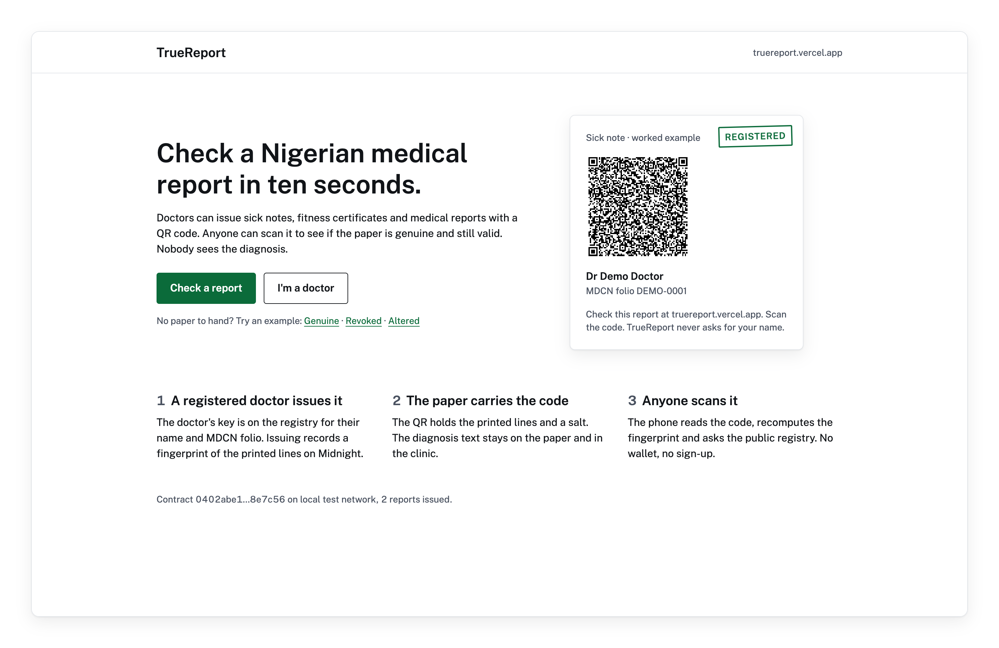
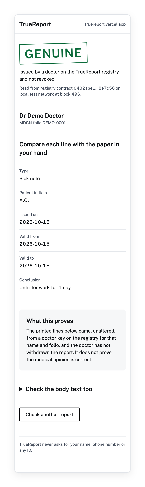
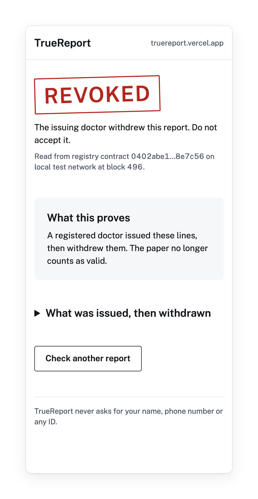
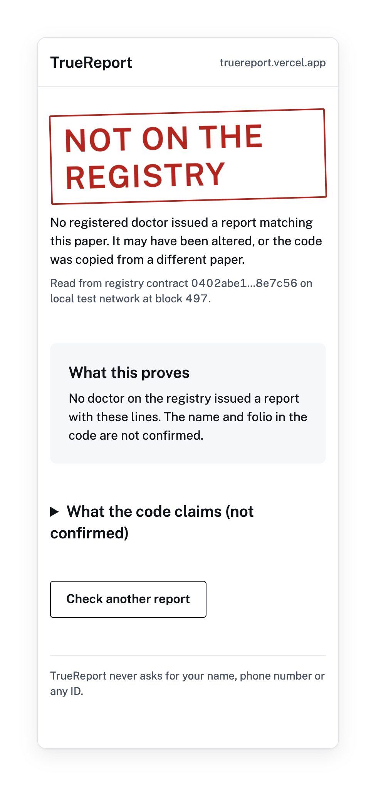
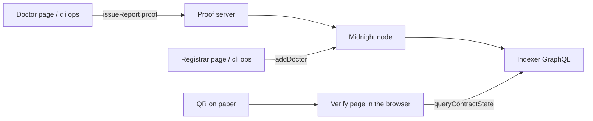

<div align="center">

# TrueReport

[](https://github.com/Yonkoo11/truereport/actions/workflows/tests.yml)

### A paper medical report anyone can check, without anyone seeing the diagnosis.

**A registered Nigerian doctor prints a QR code on a sick note or medical report. Anyone who scans it, with no wallet and no sign-up, sees whether the printed lines are unaltered, came from a doctor key on the registry for that name and folio, and are still valid. The Midnight ledger holds only salted commitments, so the diagnosis never leaves the paper.**

**[ Live ↗ ](https://truereport.vercel.app)** · **[ Verify it yourself ↗ ](#verify-it-yourself-in-60-seconds)** · **[ What's real ↗ ](#whats-real-and-what-we-deliberately-did-not-claim)**

Built for the Midnight Buildathon, Wave 2 (AKINDO WaveHack).

</div>

<p align="center"></p>

---

## ▶ What a scan shows

*Captured from the real site running against a local Midnight devnet, using reports issued by the command line tool in `cli/`.*

| A genuine report: the doctor, every printed line, and what that proves | A revoked report: the doctor withdrew it, the lines are folded away | An altered paper: one word changed, the registry has never seen it |
|---|---|---|
|  |  |  |

---

## Table of contents
- [The problem](#the-problem)
- [What TrueReport is](#what-truereport-is)
- [Verify it yourself in 60 seconds](#verify-it-yourself-in-60-seconds)
- [The contract](#the-contract)
- [Architecture](#architecture)
- [What's real, and what we deliberately did not claim](#whats-real-and-what-we-deliberately-did-not-claim)
- [Run it against a network](#run-it-against-a-network)
- [Project layout](#project-layout)

## The problem
- **A sick note is a sheet of paper.** An HR desk, a school or an insurer that receives one has no way to tell whether a doctor wrote it, whether someone edited the dates, or whether the doctor later withdrew it. Calling the clinic is the only check, and it rarely happens.
- **The obvious fix leaks health data.** Putting reports in a shared database, or on a public chain, means the diagnosis now lives somewhere other than the paper and the clinic.
- **The checker is a stranger.** The person holding the paper will not install a wallet or create an account to check one note.

## What TrueReport is
A public registry of doctor keys and report fingerprints on Midnight, plus a web page that checks a paper against it. The loop:

<div align="center">

**`REGISTER DOCTOR → ISSUE (ZK PROOF) → PRINT QR → ANYONE SCANS`**

</div>

1. **Register.** A registrar adds a doctor's leaf, `hash(doctor key, name + MDCN folio)`, to a Merkle tree on the ledger.
2. **Issue.** The doctor proves in zero knowledge that they hold the key behind one leaf of that tree. Only a salted commitment to the report and an unlinkable revoke tag reach the ledger: not the text, not which doctor.
3. **Print.** The QR holds the printed lines and the salt. The diagnosis text is not in the QR; it stays on the paper.
4. **Scan.** The verify page rebuilds the commitment from what the QR says, reads the public ledger through the indexer, and shows Genuine, Revoked, Not on the registry, or Not valid. No wallet, no server of ours in between.

## Verify it yourself in 60 seconds
No wallet, no key, no network access beyond npm. Every line below was run on a fresh copy of this repository before it was written here; the expected results are in the comments.

```bash
git clone https://github.com/Yonkoo11/truereport && cd truereport
npm ci --no-audit --no-fund        # → added 301 packages in 5s
cd contract && npx vitest run      # → Test Files 1 passed (1) · Tests 21 passed (21)
```

The 21 tests run the compiled contract (`contract/managed/`) in the Compact simulator. They show that only the registrar adds doctors, that a key not on the registry, or a registered key claiming another doctor's name and folio, is refused, that only the issuing doctor can revoke, that an edited date gives a commitment the ledger never saw, and that the QR payload carries no diagnosis text. They do not touch a live network; for that, see below.

## The contract
`contract/truereport.compact`, 94 lines, Compact 0.23.

| Ledger field | Holds |
|---|---|
| `registrar` | hash of the registrar's key |
| `doctors` | Merkle tree (depth 10) of doctor leaves |
| `doctorSlot`, `doctorCount` | where each leaf sits, so a doctor can be removed |
| `issued` | report commitment → revoke tag |
| `revoked` | revoked commitments |

| Circuit | Who can call it | What it checks |
|---|---|---|
| `addDoctor(leaf)` | registrar | caller's key hashes to `registrar`; leaf is new |
| `removeDoctor(leaf)` | registrar | leaf exists; its slot is cleared from the tree |
| `issueReport(reportHash, doctorId, salt)` | a registered doctor | a Merkle path from `hash(key, doctorId)` to a current root; the commitment is new. All three arguments stay private. |
| `revokeReport(commitment)` | the issuing doctor | `hash(key, commitment)` equals the stored revoke tag |

## Architecture



The verify page (`web/src/lib/verify.ts`) recomputes the commitment with the same code the contract tests use (`contract/src/report.ts`) and decodes ledger state in the browser.

## What's real, and what we deliberately did not claim

| Capability | Status |
|---|---|
| **Contract: register, issue, revoke, refuse impostors** | Real. 21 simulator tests. The CI workflow in `.github/workflows/tests.yml` runs them on every push. |
| **Full flow on a Midnight network** | Real on a local devnet (node 1.0.0, indexer 4.3.3, proof server 8.1.0): add a doctor, issue two reports, revoke one, an impostor key refused, a no-wallet read. |
| **Verify page against that network** | Real on the local devnet: Genuine, Revoked and Altered examples land on the right verdict in a headless browser (the stills above). |
| **Midnight Preview** | Real. Registry `bc6440d9…69182b4` on Preview: doctor registered (block 1320515), two reports issued, one revoked, impostor refused; the live site reads it (Genuine / Revoked / Not valid checked in headless Chrome, 0 console errors). |
| Issuing and revoking from the web pages with the Lace wallet | Built, not yet tested on any network. The command line tool in `cli/` is the tested path. |
| Diagnosis privacy | The ledger stores commitments only, and the QR carries no diagnosis text (tested). Whoever holds the paper can read it, as today. |
| That the medical opinion is correct | Not claimed. A Genuine result proves origin, integrity and revocation status, nothing about the medicine. |
| "Can't be faked" | Not claimed, anywhere in this repository. A doctor key that is stolen can issue real-looking reports until the registrar removes it. |
| Registrar checks against the MDCN register | Manual in V1: the operator checks each doctor before adding them. No live MDCN integration. |

## Run it against a network
Needs Docker for the proof server and the Compact toolchain only if you recompile.

```bash
npm run compile                                   # optional: rebuild contract/managed with compact
cd cli
npx tsx src/deploy.ts --network preview           # deploys the registry (wallet needs tNIGHT from the faucet)
npm run ops -- add-doctor "Dr Demo Doctor" "DEMO-0001" --network preview
npm run ops -- issue-demo --network preview       # prints a verify link
npm run read -- --network preview                 # no-wallet read of the public ledger
cd ../web && VITE_CONTRACT_ADDRESS=<address> npx vite
```

## Tech stack
- **Contract:** Compact 0.23, Midnight.js 4.1.1 · **Tests:** 21, Vitest
- **Site:** Vite + React, on Vercel · **Network:** Midnight Preview (local devnet for tests)

## Project layout
```
contract/
  truereport.compact   # the registry: 4 circuits, 6 ledger fields
  src/report.ts        # QR payload, normalisation, commitment (shared with the web page)
  test/                # 21 simulator tests
  managed/             # compiled circuits, keys and ZKIR
cli/src/
  deploy.ts            # deploy the registry
  ops.ts               # add-doctor, issue-demo, revoke
  read.ts              # no-wallet ledger read through the indexer
web/src/
  pages/               # Home, Verify, Doctor, Registrar
  lib/verify.ts        # the stranger's check: rebuild commitment, read ledger, pick a verdict
scripts/
  readme-images.mjs    # builds the README pictures from captures of the running site
proof-server/          # Dockerfile for the proof server
```

## License
Apache-2.0. See [LICENSE](LICENSE).
